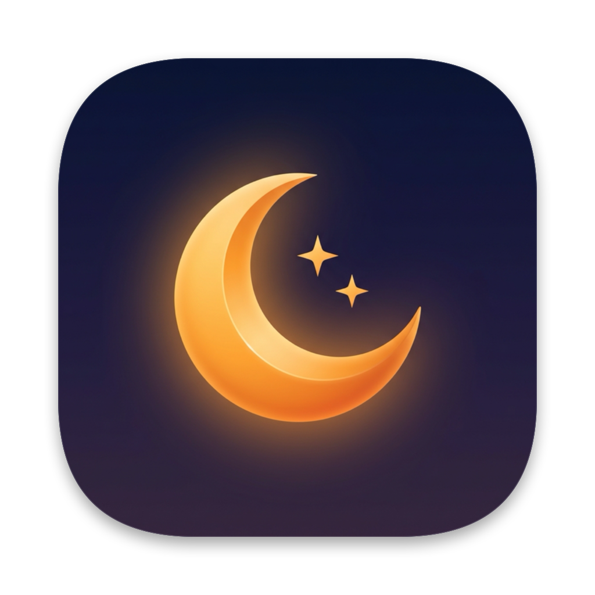

<p align="center">
  
</p>

# NightShiftAlwaysOn

A lightweight native macOS menu bar app & login agent that keeps **Night Shift** permanently **ON**—eliminating macOS's 6:59 / 7:00 AM turn-off flash—while **immediately respecting you if you manually click Night Shift off**.

## How it works

macOS does not offer an "Always On" Night Shift option:
- Leaving Schedule **Off** and clicking *Turn On Until Tomorrow* resets at 7:00 AM.
- Setting a Custom Schedule like `07:00` → `06:59` still flashes your display bright blue for 1 minute every day at `06:59`.

`NightShiftAlwaysOn` uses Apple's native `CoreBrightness` (`CBBlueLightClient`) framework with a **sliding 12-hour schedule**:

1. While Night Shift is ON, it sets the Custom Schedule's 1-minute off-gap to **12 hours in the future** and silently slides that gap forward every 30 minutes (and after sleep/wake or clock/timezone changes). The clock **never reaches the off-gap**, so Night Shift never flickers or turns off.
2. It listens for real-time `CBBlueLightClient` status notifications:
   - **Manual OFF:** If you click Night Shift **off** in macOS Control Center, System Settings, or the menu bar icon, it immediately pauses Always-On mode, sets Schedule to Off, and leaves Night Shift off until you turn it back on.
   - **Manual ON:** As soon as you click Night Shift **on** again anywhere in macOS (or the menu bar icon), it resumes Always-On protection automatically.

## Download (Prebuilt Release)

1. Download `NightShiftAlwaysOn-v1.0.0-macos-universal.zip` from the [Latest Release](https://github.com/m-borg/night-shift-always-on/releases/latest).
2. Unzip and move `NightShiftAlwaysOn.app` to `/Applications` or `~/Applications`.
3. Launch it (on first open, if macOS Gatekeeper warns about an unsigned app, right-click → **Open** or run `xattr -dr com.apple.quarantine /Applications/NightShiftAlwaysOn.app`).
4. Click the moon icon in the menu bar and enable **Start at Login**.

## Build & Install from Source

Requires macOS 13+ and Xcode Command Line Tools (`swiftc` / `clang`).

```bash
./install.sh     # Builds, installs to ~/Applications, enables Start at Login, and starts it
./uninstall.sh   # Stops and removes the app and LaunchAgent
```

To build a Universal (`arm64` + `x86_64`) `.app` bundle:

```bash
./build.sh --universal
```

## CLI & Apple Shortcuts

After installing from source, you can control or inspect Night Shift from Terminal or an Apple Shortcut (**Run Shell Script** action):

```bash
~/.local/bin/nightshift-always-on --status
~/.local/bin/nightshift-always-on --on
~/.local/bin/nightshift-always-on --off
~/.local/bin/nightshift-always-on --toggle
```
